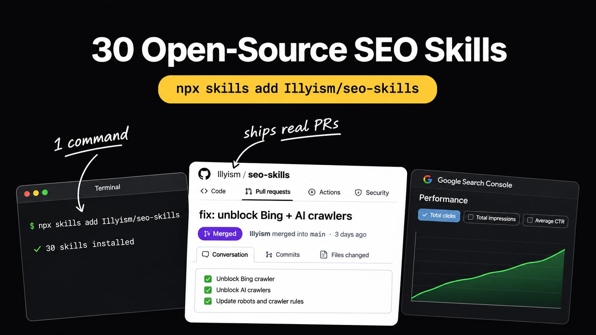
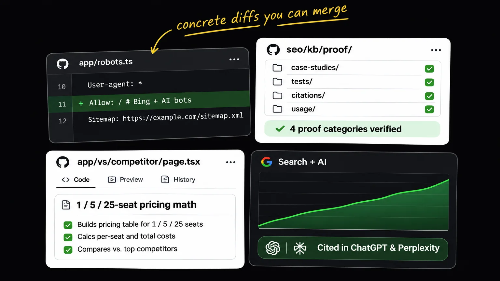

<h1 align="center">SEO Skills for Claude Code, Cursor &amp; AI Agents</h1>

<p align="center">
  <strong>30 open-source <code>SKILL.md</code> workflows that end in a merged PR or a file in your repo, not an audit PDF.</strong>
</p>

<p align="center">
  <a href="https://github.com/Illyism/seo-skills/stargazers"></a>
  <a href="https://agentskills.io"></a>
  <a href="https://il.ly/skills"></a>
  <a href="#license"></a>
</p>

<p align="center">
  <a href="https://il.ly/skills">Web catalog</a> ·
  <a href="#install">Install</a> ·
  <a href="#all-30-seo-skills">Skills</a> ·
  <a href="#end-to-end-seo-workflows">Workflows</a> ·
  <a href="#live-seo-data-via-mcp-servers">MCP servers</a> ·
  <a href="#sponsors">Sponsors</a> ·
  <a href="#faq">FAQ</a>
</p>



## Install

```bash
# All 30 skills
npx skills add Illyism/seo-skills

# One skill
npx skills add Illyism/seo-skills --skill seo-autopilot

# List what is available
npx skills add Illyism/seo-skills --list
```

Each skill is a folder with one Markdown `SKILL.md` that follows the [Agent Skills specification](https://agentskills.io). The agent reads only the `name` and `description` at startup and opens the full file when your prompt matches.

| Environment | Where `SKILL.md` lives | Install |
| --- | --- | --- |
| Claude Code | `.claude/skills/` or `~/.claude/skills/` | `npx skills add Illyism/seo-skills -a claude-code` |
| Cursor | `.cursor/skills/` or `.agents/skills/` | `npx skills add Illyism/seo-skills -a cursor` |
| Codex, OpenCode, Windsurf, Cline, Roo Code | `.agents/skills/` | `npx skills add Illyism/seo-skills` |
| ChatGPT, Claude.ai, Perplexity, Grok | Paste the Markdown | Copy any skill from [il.ly/skills](https://il.ly/skills) |

## What you get

Most SEO prompt packs produce checklists and health scores. Each skill here ends in something you can ship:

- **Diffs you can merge:** rewritten titles and H1s, refreshed posts, `robots.txt` and bot rules, verified `301` maps, new `/vs/` routes.
- **Proof in place of filler:** `proof-kb`, `seo-blog-images`, and `unslop-seo` swap generic copy for your own benchmarks, screenshots, and charts.
- **One page at a time:** `blitz-seo` puts 30 days of fixes, internal links, and backlinks on a single money page.
- **Google and AI search together:** map the prompts buyers ask ChatGPT, Perplexity, Gemini, and AI Overviews, track who gets cited, and ship pages for the prompts you are missing.



## All 30 SEO skills

### Technical, research, and on-page

| Skill | What it ships | Example prompt |
| --- | --- | --- |
| [`seo-autopilot`](seo/seo-autopilot/SKILL.md) | A daily SEO agent for your repo with state in `seo/`: health checks, fact checks against recent commits, page-2 pushes, competitor sitemap diffs, a monthly keyword map | *"Run `seo-autopilot` on this repo and open a PR with today's top fix"* |
| [`seo-roast`](seo/seo-roast/SKILL.md) | A blunt teardown that fixes crawl, `robots.txt`, programmatic, layout, and AI-visibility blockers in a PR, then writes `seo/roast-roadmap.md` ordered by revenue | *"Run `seo-roast` on our repo and fix the fatal blockers in a PR"* |
| [`blitz-seo`](seo/blitz-seo/SKILL.md) | A 30-day sprint plan to rank one page for one money keyword | *"Run a 30-day `blitz-seo` sprint to push `/pricing` from #14 to the top 3"* |
| [`ahrefs-research`](seo/ahrefs-research/SKILL.md) | Ahrefs MCP or API v3 workflows: competitor top-pages gaps (`seo/competitor-gaps.md`) with scaffolded routes, a fake-DR filter (`seo/link-targets.csv`), subreddit topic mining, link-insertion page matching | *"Use `ahrefs-research` to diff our top pages against 5 competitors and scaffold the #1 gap"* |
| [`dataforseo-serp`](seo/dataforseo-serp/SKILL.md) | Live SERP workflows: keyword clusters by top-10 URL overlap (`seo/keyword-clusters.json`), a free-tool filter by CPC and volume, AI Overview citation sources, an intent check before you write | *"Use `dataforseo-serp` to cluster these 40 keywords so we don't cannibalize"* |
| [`proof-kb`](seo/proof-kb/SKILL.md) | A fact store in `seo/kb/` (brand facts, benchmark and customer proof cards) that drafts pull from, plus `route-fact` to update every page when a number changes | *"Run `proof-kb` init and upgrade `content/blog/postgres-branching.mdx` with our benchmark"* |
| [`vs-and-alternatives`](seo/vs-and-alternatives/SKILL.md) | `/vs/[competitor]`, `/[competitor]-alternative`, and "best for [persona]" routes built on sourced switching triggers, seat-based pricing math, and migration steps | *"Use `vs-and-alternatives` to ship `/vs/billstack` and link it from the footer"* |
| [`internal-linking`](seo/internal-linking/SKILL.md) | A link-graph audit (`scripts/internal-link-graph.mjs`) and body links from your top posts into `/pricing`, `/vs/*`, and `/tools/*` | *"Run `internal-linking` to fix orphan money pages"* |
| [`domain-migration`](seo/domain-migration/SKILL.md) | A rebrand or subdomain-to-subfolder move: full URL and backlink inventory, 1-hop `301` config, `scripts/verify-redirects.sh`, and backlink update emails | *"Run `domain-migration` to move `blog.acme.com` into `acme.com/blog`"* |
| [`seo-title-optimization`](seo/seo-title-optimization/SKILL.md) | Title tag, frontmatter `title`, and H1 rewrites checked against the live SERP and truncation limits | *"Audit every page title in `app/` and `content/blog/` for CTR and truncation"* |
| [`blog-refresher`](seo/blog-refresher/SKILL.md) | A refresh of a slipping post: compares it with the current top 10 and rewrites the weak sections in your voice | *"Use `blog-refresher` on `content/blog/best-crm.mdx`"* |
| [`block-ai-scrapers`](seo/block-ai-scrapers/SKILL.md) | A bot firewall that stops AI agents, `curl`, and headless scrapers from burning API and DB credits, keeps verified Googlebot indexing, and points blocked agents at your product | *"Add `block-ai-scrapers` to protect our `/directory` routes without hurting Googlebot"* |

### AI search (GEO)

| Skill | What it ships | Example prompt |
| --- | --- | --- |
| [`customer-journey`](marketing/customer-journey/SKILL.md) | A 5-stage awareness map with the Google keywords and AI prompts buyers use at each stage | *"Map the `customer-journey` and AI search prompts for our B2B analytics SaaS"* |
| [`aiseotracker`](seo/aiseotracker/SKILL.md) | MCP setup for [AI SEO Tracker](https://aiseotracker.com): mentions, citations, and competitors across ChatGPT, Perplexity, Gemini, Copilot, and AI Overviews | *"Connect `aiseotracker` and check how ChatGPT and Perplexity rank our domain"* |
| [`ai-seo-report`](seo/ai-seo-report/SKILL.md) | A short AI visibility brief from live scans: who gets cited, what changed, what to do | *"Give me this week's `ai-seo-report` and tell me why competitors beat us in ChatGPT"* |
| [`content-coverage`](seo/content-coverage/SKILL.md) | A content plan and drafts for the prompt clusters where competitors get cited and you don't | *"Run `content-coverage` for our missing Perplexity and ChatGPT prompts"* |
| [`reddit-serp`](seo/reddit-serp/SKILL.md) | A queue (`seo/reddit-serp-queue.md`) of unlocked Reddit threads that rank on page 1 or get cited by AI, with replies written to survive moderation | *"Run `reddit-serp` for our category and draft replies"* |

### Links and directories

| Skill | What it ships | Example prompt |
| --- | --- | --- |
| [`directory-submissions`](seo/directory-submissions/SKILL.md) | One `submission-manifest.json`, the repo files that 15+ MCP and agent registries index, and a 50-directory sequence ([850+ more](https://linkdr.com/resources/directories)) | *"Run `directory-submissions` to build our manifest and submit waves 1-3"* |
| [`linkdr`](seo/linkdr/SKILL.md) | A backlink plan for [LinkDR](https://linkdr.com): a DR 30+ to DR 60+ mix for your budget and one checkout link you approve | *"Plan a $1,000 backlink campaign for our homepage with `linkdr`"* |
| [`honest-link-outreach`](seo/honest-link-outreach/SKILL.md) | An outreach batch file with a SEND/CUT prospect table and emails that state the ask first and differ in structure | *"Run `honest-link-outreach` on these 8 partner and blog domains"* |
| [`awesome-tools`](seo/awesome-tools/SKILL.md) | A submission to [Awesome Tools](https://awesome.tools) over MCP or JSON API for a verified dofollow listing | *"Submit our app to `awesome-tools` and check if we qualify for the free listing"* |

### Content and distribution

| Skill | What it ships | Example prompt |
| --- | --- | --- |
| [`unslop-seo`](content/unslop-seo/SKILL.md) | An in-place edit that grounds vague claims in real facts, puts the answer in the first 40 words, and strips 20 AI writing patterns, with a check script | *"Run `unslop-seo` on `content/blog/ci-guide.mdx`"* |
| [`seo-blog-images`](content/seo-blog-images/SKILL.md) | Cover images, screenshots, and SVG charts that are generated, compressed, checked, and wired into the post with filenames, sizes, and alt text | *"Use `seo-blog-images` to add a cover and a benchmark chart to `content/blog/benchmark.mdx`"* |
| [`youtube-seo`](content/youtube-seo/SKILL.md) | Titles, a chaptered description, launch posts, and a `VideoObject` embed from a recording or `.srt` | *"Run `youtube-seo` on `demo.srt` and embed the video in the matching post"* |
| [`parasite-and-pr`](marketing/parasite-and-pr/SKILL.md) | A syndication bundle in `marketing/distribution/<slug>/`: a press release with privacy-safe contact fields, a canonicalized Dev.to draft, a LinkedIn article, and a checklist | *"Run `parasite-and-pr` for our 2026 latency benchmark"* |
| [`intro`](content/intro/SKILL.md) | Short blog intros matched to listicle, how-to, definition, or debate intent ([examples](content/intro/examples.md)) | *"Rewrite the opening of this post with `intro` for listicle intent"* |
| [`scribiz`](content/scribiz/SKILL.md) | Transcripts with speakers, on-screen text, and chapters from video or audio via [Scribiz](https://scribiz.com) | *"Transcribe this YouTube demo with `scribiz` and turn it into a tutorial post"* |
| [`diff-marketing`](marketing/diff-marketing/SKILL.md) | Changelog entries, feature articles, and launch posts drafted from recent commits and merged PRs | *"Read the last 2 weeks of commits with `diff-marketing` and draft 3 launch angles"* |

### Copywriting

| Skill | What it ships | Example prompt |
| --- | --- | --- |
| [`understand-customers`](copywriting/understand-customers/SKILL.md) | A buyer research brief: pains, failed alternatives, desired outcome, and the words they use | *"Run `understand-customers` for indie Next.js founders tired of slow CI builds"* |
| [`blitz-copy`](copywriting/blitz-copy/SKILL.md) | Landing page, email, and hook copy on the Hook, Spike, Payoff formula | *"Rewrite our hero section and pricing CTAs with `blitz-copy`"* |

For engineering skills (AI evals, Chrome Web Store releases), see [Illyism/dev-skills](https://github.com/Illyism/dev-skills).

## End-to-end SEO workflows

The skills chain. Six that work well:

1. **Ship a post with first-hand proof.** `dataforseo-serp` (cluster and check intent) → `proof-kb` (add your benchmarks) → `seo-blog-images` → `unslop-seo` → `internal-linking` → `parasite-and-pr`.
2. **Win buyers leaving a competitor.** `ahrefs-research` (diff their top pages) → `vs-and-alternatives` → `reddit-serp` → `honest-link-outreach`.
3. **Push a page-2 URL into the top 3.** `seo-title-optimization` → `blog-refresher` → `intro` → `linkdr` (2-4 DR 40+ links at the refreshed URL).
4. **Get cited by ChatGPT, Perplexity, and AI Overviews.** `customer-journey` → `aiseotracker` → `ai-seo-report` → `content-coverage`.
5. **Launch from DR 0.** `understand-customers` → `blitz-copy` → `directory-submissions` and `awesome-tools` → `blitz-seo`.
6. **Daily repo SEO.** Run `seo-autopilot` on a schedule so the agent checks site health, verifies claims against recent commits, and opens PRs. Add `diff-marketing` weekly to turn shipped code into posts.

## Live SEO data via MCP servers

A skill is the method. An [MCP](https://modelcontextprotocol.io) server gives the agent live data to run it on. Three are preconfigured in [`.mcp.json`](.mcp.json):

| Server | Endpoint | What it gives the agent |
| --- | --- | --- |
| [AI SEO Tracker](https://aiseotracker.com) | `https://aiseotracker.com/api/agent/mcp` ([repo](https://github.com/Illyism/aiseotracker-mcp)) | Prompt rankings, cited URLs, and competitor share across ChatGPT, Perplexity, Gemini, Copilot, and AI Overviews |
| [Scribiz](https://scribiz.com) | `https://scribiz.com/mcp` | Transcripts with speakers, on-screen text, summaries, and chapters |
| [Awesome Tools](https://awesome.tools) | `https://awesome.tools/mcp` ([repo](https://github.com/Illyism/awesome-tools-mcp)) | Tool search, directory submissions, and backlink verification |

Related, not in `.mcp.json`: the [LinkDR agent skill](https://linkdr.com/SKILL.md) plans backlink orders and returns one checkout link, and the [GenPPT MCP](https://github.com/Illyism/genppt-mcp) turns an audit or roadmap into a `.pptx` or PDF deck.

## Companion resources

- [71-point SEO launch checklist](https://il.ly/growth): free pass/fail checks, each with a test command, plus a 50-directory launch tracker.
- [850+ startup, AI tool, and MCP directories](https://linkdr.com/resources/directories): filter by DR, traffic, price, and link type, with submit URLs.

## Sponsors

MIT-licensed and maintained by [Ilias Ism](https://il.ly), supported by these products:

| Product | What it does |
| --- | --- |
| [LinkDR](https://linkdr.com) | Managed backlinks at DR 30-60+. You can approve every publisher site before placement. 15% off monthly plans. |
| [AI SEO Tracker](https://aiseotracker.com) | Tracks whether ChatGPT, Perplexity, Gemini, Copilot, and AI Overviews cite your brand, and which competitor pages they cite instead. |
| [GenPPT](https://genppt.com) | Turns notes, reports, and PDFs into editable PowerPoint and Google Slides decks. |
| [Scribiz](https://scribiz.com) | Transcribes video and audio with speaker labels, on-screen text, and chapters. Web, macOS, Android, CLI. |
| [Awesome Tools](https://awesome.tools) | A curated SaaS and developer tools directory. Submit your product for a verified dofollow listing. |
| [SEO Roast](https://seoroast.com) | A recorded 20-minute video teardown of your site with a 90-day plan. |
| [XOutlier](https://xoutlier.com) | A free Chrome extension that finds outlier posts across 390,000+ creators on X. |

## FAQ

### What are SEO skills for AI agents?

A skill is a folder with a `SKILL.md` file: instructions, checks, and output templates that teach a coding agent (Claude Code, Cursor, Codex, OpenCode, Windsurf) one SEO job, such as a technical audit, a title rewrite, a content refresh, or a backlink plan.

### How do I use them in Claude Code or Cursor?

Run `npx skills add Illyism/seo-skills` in your project, or globally. The agent loads a skill when your prompt matches its description. You can also name it: *"Use `blog-refresher` on `content/blog/post.mdx`"*.

### Can I use them in ChatGPT, Claude.ai, or Perplexity?

Yes. Open [il.ly/skills](https://il.ly/skills), pick a skill, and copy the prompt into the chat.

### What is the difference between a skill and an MCP server?

A skill tells the agent how to do the job. An MCP server connects it to live data and actions: SERPs, AI citation scans, transcripts, checkouts. Most workflows here use both.

## License

MIT © [Ilias Ism](https://il.ly)
